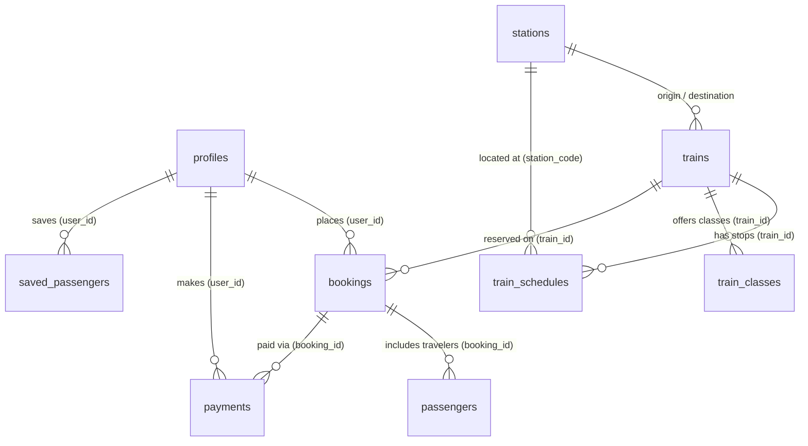

# RailYatra — Complete Indian Railway Reservation System

> **Your Journey, Our Priority.**

RailYatra is a complete, full-stack Indian Railway Reservation System built for real passenger workflows and full-stack learning. It supports **Guest Users**, **Registered & Email-Verified Users**, and **Administrators**, featuring train search across intermediate route stops, full timetables, live train running status tracking, 10-digit PNR lookup, multi-passenger ticket booking with berth preferences, simulated UPI/Card/NetBanking/Wallet payment processing, printable E-Tickets, cancellations with automated refunds, and an Admin Operations Console.

---

## Table of Contents

1. [Technology Stack](#1-technology-stack)
2. [User Categories & Capabilities](#2-user-categories--capabilities)
3. [Project Folder Structure](#3-project-folder-structure)
4. [Installation Instructions](#4-installation-instructions)
5. [Environment Variable Configuration](#5-environment-variable-configuration)
6. [Supabase Setup (PostgreSQL, Auth & RLS)](#6-supabase-setup-postgresql-auth--rls)
7. [Database Schema & Relationships](#7-database-schema--relationships)
8. [SMTP Email Configuration](#8-smtp-email-configuration)
9. [API Integration Details](#9-api-integration-details)
10. [Authentication Workflow](#10-authentication-workflow)
11. [Running Locally & Sample PNRs](#11-running-locally--sample-pnrs)
12. [Building & Deploying to Production](#12-building--deploying-to-production)

---

## 1. Technology Stack

| Layer | Technologies |
| :--- | :--- |
| **Frontend** | React 19, TypeScript, Vite 6, Tailwind CSS 3, React Router DOM 7, Lucide Icons |
| **Backend API** | Node.js, Express 4, TypeScript, Helmet, CORS |
| **Database & Auth** | **Dual-Mode Adapter:**<br>• **Supabase Mode:** Supabase Auth + Supabase PostgreSQL with Row Level Security (RLS)<br>• **Local Mode (zero-config default):** Built-in `node:sqlite` (`server/data/railyatra.db`) + `scrypt` password hashing + HMAC-SHA256 JWTs |
| **Email Service** | Nodemailer (SMTP) + Dev Email Outbox preview when SMTP variables are unset |
| **Live Train Tracking** | External RapidAPI / RailRadar HTTP integration + schedule-synchronized IST live tracker fallback |
| **Testing** | Node native test runner (`node:test`) + `tsc` strict type-checking + Vite production bundling |

---

## 2. User Categories & Capabilities

1. **Guest Users (Unauthenticated)**
   - Search trains between any two stations (including intermediate stops) by date, class, and passenger count.
   - Explore complete train schedules and station timetables.
   - Track live train running status and current station progress.
   - Check 10-digit PNR reservation status (with personal email/phone masked for privacy).
   - Submit inquiries on the Contact Us page.
   - Register an account, verify email, log in, or reset password.

2. **Registered Users (Authenticated & Email-Verified)**
   - Everything Guest Users can do, plus:
   - Book tickets for 1–6 passengers with berth preferences (`Lower`, `Middle`, `Upper`, `Side Lower`, `Side Upper`, `Window`, `Aisle`).
   - Automatic coach/seat allocation (`CNF`), or `RAC` / `WL` fallback when capacity is full.
   - Complete payment via UPI, Card, NetBanking, or Wallet.
   - View printable Electronic Reservation Slips (E-Tickets) with QR verification graphic.
   - Cancel entire tickets or individual passengers with instant refund calculation (90% base fare + GST).
   - Access personal **Dashboard** (`/dashboard`) to manage saved co-passengers, profile details, and password.

3. **Administrators (`role = 'admin'`)**
   - Protected **Admin Operations Console** (`/admin`) guarded by both frontend route guards and backend `requireAdmin` middleware.
   - View system revenue, bookings, active fleets, and class-wise analytics.
   - Add new stations, publish new express trains with schedules/classes, and activate/suspend trains.
   - Inspect all bookings, prepare reservation charts, manage user roles, and resolve Contact Us inquiries.

---

## 3. Project Folder Structure

```text
RailYatra/
├── README.md                           # Project documentation & setup guide
├── DEVELOPMENT_GUIDE.md                # Learning guide: architecture, file map & workflows
├── package.json                        # Root scripts & Node engine config
├── vercel.json                         # Full-stack Vercel build, serverless & SPA rewrite config
├── api/
│   └── index.mjs                       # Vercel Serverless Express entrypoint (`/api/*`)
├── scripts/
│   └── dev.mjs                         # Launches Express backend + Vite frontend together
├── supabase/
│   └── migrations/
│       └── 001_initial_schema.sql      # Complete Supabase PostgreSQL schema, triggers & RLS policies
├── server/                             # Express + TypeScript Backend API
│   ├── .env.example
│   ├── package.json
│   ├── tsconfig.json
│   ├── tests/
│   │   └── api.test.ts                 # Automated end-to-end API integration tests
│   └── src/
│       ├── index.ts                    # Express app setup, security middleware & route mounting
│       ├── config/env.ts               # Validated environment config & provider auto-detection
│       ├── db/
│       │   ├── schema.sql              # Local SQLite relational schema
│       │   ├── sqliteClient.ts         # node:sqlite DatabaseSync connection & auto-seeding
│       │   ├── supabaseClient.ts       # Supabase Admin, Anon & RLS-scoped User clients
│       │   └── repository.ts           # Unified data layer delegating to Supabase or SQLite
│       ├── middleware/
│       │   ├── authMiddleware.ts       # JWT / Supabase token verification & email check
│       │   ├── adminMiddleware.ts      # Role-based admin authorization check
│       │   └── errorHandler.ts         # AppError class, asyncHandler & JSON error formatter
│       ├── services/
│       │   ├── authService.ts          # Registration, verification, login, password reset
│       │   ├── trainService.ts         # Station/train search, segment fares & availability
│       │   ├── bookingService.ts       # Seat allocation, PNR creation, lookup & cancellations
│       │   ├── paymentService.ts       # Fare quote, GST, payment validation & refunds
│       │   ├── railwayApiService.ts    # External Railway API client + live IST simulator
│       │   ├── emailService.ts         # Nodemailer SMTP & Dev Email Outbox
│       │   └── adminService.ts         # Analytics & Admin CRUD operations
│       ├── routes/                     # Modular Express routers
│       └── utils/
│           ├── crypto.ts               # scrypt password hashing, JWT signing, PNR/TXN generators
│           ├── seedData.ts             # 26 Indian stations, 14 trains, demo accounts & sample PNRs
│           └── runSeed.ts              # CLI seed script
└── client/                             # React + Vite + TypeScript + Tailwind CSS Frontend
    ├── .env.example
    ├── index.html
    ├── vite.config.ts                  # Proxies /api -> http://localhost:5000
    ├── public/images/
    │   └── vande-bharat-hero.jpg       # Vande Bharat hero illustration
    └── src/
        ├── App.tsx                     # Router + AuthProvider + ProtectedRoute guards
        ├── context/AuthContext.tsx     # Global auth state & session persistence
        ├── services/                   # Typed API clients talking to /api/*
        ├── components/                 # Navbar, HeroSection, TrainSearchWidget, ETicketModal, etc.
        └── pages/                      # Home, Search, Schedule, Tracking, PNR, Book, Bookings, Dashboard, Admin, Auth
```

---

## 4. Installation Instructions

### Prerequisites
- **Node.js v22.5+** (tested on Node `v26.13.1`, which includes built-in `node:sqlite`)
- **npm 10+** (`npm.cmd` on Windows PowerShell if script execution policy restricts `npm.ps1`)

### Install Dependencies
From the root `RailYatra` directory:

```bash
npm run install:all
```

Or install each workspace individually:

```bash
npm --prefix server install
npm --prefix client install
```

---

## 5. Environment Variable Configuration

RailYatra works **out of the box in Local Mode** even before creating `.env` files! To customize settings or enable Supabase, SMTP, or an external Railway API:

```bash
cp server/.env.example server/.env
cp client/.env.example client/.env
```

### Backend Variables (`server/.env`)

| Variable | Required | Default | Description |
| :--- | :--- | :--- | :--- |
| `PORT` | No | `5000` | Express API listening port |
| `CLIENT_URL` | No | `http://localhost:5173` | Allowed CORS origin & base URL for verification links |
| `JWT_SECRET` | Prod: Yes | Dev fallback | Secret key used to sign local HMAC-SHA256 JWT tokens |
| `DATA_PROVIDER` | No | `auto` | `auto` (uses Supabase if configured, else SQLite), `local`, or `supabase` |
| `SUPABASE_URL` | Supabase | `""` | Your Supabase project URL (`https://xxx.supabase.co`) |
| `SUPABASE_ANON_KEY` | Supabase | `""` | Supabase public anon key |
| `SUPABASE_SERVICE_ROLE_KEY` | Supabase | `""` | Supabase service role key (server-side only; never expose to client!) |
| `SMTP_HOST` | Optional | `""` | SMTP hostname (e.g., `smtp.gmail.com` or `sandbox.smtp.mailtrap.io`) |
| `SMTP_PORT` | Optional | `587` | SMTP port (`587` STARTTLS or `465` SSL) |
| `SMTP_SECURE` | Optional | `false` | `true` for port `465`, `false` for `587` |
| `SMTP_USER` | Optional | `""` | SMTP username |
| `SMTP_PASS` | Optional | `""` | SMTP password or App Password |
| `SMTP_FROM` | Optional | `"RailYatra Support <no-reply@railyatra.in>"` | Email sender header |
| `RAILCORE_API_URL` | Optional | `https://ir.railcore.tech` | RailCore Indian Railway Live Tracking API base URL |
| `RAILCORE_API_KEY` | Optional | `""` | RailCore API key (`X-RailCore-Key` header) |
| `RAILWAY_API_URL` | Optional | `""` | Alternative RapidAPI Indian Railway Live Status endpoint |
| `RAILWAY_API_KEY` | Optional | `""` | Alternative RapidAPI key |
| `RAILWAY_API_HOST` | Optional | `""` | Alternative RapidAPI host header |

### Frontend Variables (`client/.env`)

| Variable | Default | Description |
| :--- | :--- | :--- |
| `VITE_API_BASE_URL` | `/api` | Base URL for backend API requests (proxied in dev via `vite.config.ts`) |

---

## 6. Supabase Setup (PostgreSQL, Auth & RLS)

Follow these steps to connect RailYatra to a live Supabase project:

1. Create a new project at [https://supabase.com](https://supabase.com).
2. Open **SQL Editor** in your Supabase Dashboard and execute the entire contents of:
   - `supabase/migrations/001_initial_schema.sql`
   This creates all tables, foreign keys, indexes, the `handle_new_user()` trigger on `auth.users`, and Row Level Security (RLS) policies.
3. In **Authentication -> URL Configuration**:
   - Set **Site URL** to `http://localhost:5173` (or your production domain).
   - Add `http://localhost:5173/verify-email` and `http://localhost:5173/reset-password` to **Redirect URLs**.
4. Copy **Project URL**, **anon public key**, and **service_role secret** from **Project Settings -> API** into `server/.env`.
5. Seed the Indian Railway stations, trains, schedules, and classes into Supabase PostgreSQL:
   ```bash
   npm run seed
   ```
6. To create an Admin user in Supabase, register normally via `/signup`, verify your email, and run in Supabase SQL Editor:
   ```sql
   UPDATE public.profiles SET role = 'admin' WHERE email = 'your-admin@example.com';
   ```

---

## 7. Database Schema & Relationships



### Core Tables
- `profiles`: Stores user identity, role (`user` | `admin`), phone, and `email_verified`. Linked 1-to-1 with `auth.users` in Supabase.
- `stations`: Indian Railway station master catalog (`code`, `name`, `city`, `state`, `zone`).
- `trains`: Train fleet metadata (`train_number`, `train_name`, `train_type`, `running_days`, `is_active`).
- `train_schedules`: Ordered route stops per train with arrival/departure timings, halt minutes, day count, distance km, and platform.
- `train_classes`: Seat capacities, coach lists, and full-route base fares (`1A`, `2A`, `3A`, `CC`, `EC`, `SL`, `2S`).
- `bookings`: Reservation master record with unique 10-digit `pnr_number`, journey date, route codes, fare breakdown, and `booking_status`.
- `passengers`: Individual passengers linked to `bookings(id)`, holding allocated `coach`, `seat_number`, `berth_type`, and `current_status` (`CNF`, `RAC`, `WL`, `CAN`).
- `payments`: Payment ledger (`transaction_id`, `payment_method`, `amount`, `status`).
- `saved_passengers` & `contact_messages`: User co-passenger master list and support inquiries.

---

## 8. SMTP Email Configuration

RailYatra uses **Nodemailer** (`server/src/services/emailService.ts`) for:
- Account verification emails after registration
- Password reset emails
- E-Ticket booking confirmation emails
- Cancellation & refund notification emails

When `SMTP_HOST`, `SMTP_USER`, and `SMTP_PASS` are **not configured** in `server/.env`, RailYatra automatically switches to its **Dev Email Outbox** for local verification previews:
- Verification URLs are printed to the server terminal (password reset links are never exposed in UI or HTTP responses).
- The Signup and Login UIs also surface a direct one-click **Dev Outbox Verify Link** in development mode so you can verify accounts immediately.

To enable real emails (e.g., Gmail App Password or Mailtrap):
```env
SMTP_HOST=smtp.gmail.com
SMTP_PORT=587
SMTP_SECURE=false
SMTP_USER=your-email@gmail.com
SMTP_PASS=your-16-char-app-password
SMTP_FROM="RailYatra Support <your-email@gmail.com>"
```

---

## 9. API Integration Details

### REST API Endpoints

| Method | Endpoint | Access | Description |
| :--- | :--- | :--- | :--- |
| `GET` | `/api/health` | Public | Server health & active provider mode |
| `POST` | `/api/auth/register` | Public | Register user & send verification email |
| `POST` | `/api/auth/verify-email` | Public | Verify email token |
| `POST` | `/api/auth/resend-verification` | Public | Resend verification link |
| `POST` | `/api/auth/login` | Public | Authenticate & issue JWT |
| `POST` | `/api/auth/forgot-password` | Public | Send password reset email |
| `POST` | `/api/auth/reset-password` | Public | Reset password with token |
| `GET` | `/api/auth/me` | Auth | Get current logged-in profile |
| `PUT` | `/api/auth/profile` | Auth | Update full name & phone |
| `POST` | `/api/auth/change-password` | Auth | Change password |
| `GET/POST/DELETE` | `/api/auth/saved-passengers` | Auth | Manage saved co-passengers |
| `GET` | `/api/stations` | Public | Search or list stations |
| `GET` | `/api/trains` | Public | List active trains with stops & classes |
| `GET` | `/api/trains/search` | Public | Search trains by `from`, `to`, `date`, `class`, `passengers` |
| `GET` | `/api/trains/:trainNumber/schedule` | Public | Get full train route timetable |
| `GET` | `/api/pnr/:pnrNumber` | Public | Check 10-digit PNR status (PII masked) |
| `GET` | `/api/tracking/:trainNumber` | Public | Live running status (External API or simulation) |
| `GET` | `/api/bookings/quote` | Public | Calculate itemized fare quote |
| `GET` | `/api/bookings/my` | Auth | List user's bookings (RLS-scoped) |
| `POST` | `/api/bookings` | Verified Auth | Create reservation + payment + allocate berths |
| `POST` | `/api/bookings/:id/cancel` | Auth (Owner/Admin) | Full or per-passenger cancellation & refund |
| `POST` | `/api/contact` | Public | Submit support inquiry |
| `GET/POST/PATCH` | `/api/admin/*` | Admin Only | Analytics, trains/stations CRUD, bookings, users, inquiries |

### External Live Train Tracking API (RailCore / RapidAPI)
In `server/src/services/railwayApiService.ts`, configuring `RAILCORE_API_KEY` (with `RAILCORE_API_URL=https://ir.railcore.tech`) connects `GET /api/tracking/:trainNumber` directly to **RailCore Live Running Status** (`GET /v1/trains/{train_number}/live?date=YYYY-MM-DD` with `X-RailCore-Key`). It also supports generic RapidAPI endpoints via `RAILWAY_API_*`, and gracefully falls back to the schedule-synchronized IST live tracker if external APIs are unconfigured or unreachable.

---

## 10. Authentication Workflow

1. **Sign Up (`/signup`)** → Frontend sends `POST /api/auth/register`.
2. **Account & Profile Creation** → Backend creates auth record (`supabase.auth.signUp` or SQLite `profiles`), hashes password with `scrypt`, generates a SHA-256 hashed verification token, and dispatches verification link via `emailService`.
3. **Email Verification (`/verify-email?token=...`)** → Frontend calls `POST /api/auth/verify-email`; backend marks `email_verified = true`.
4. **Login (`/login`)** → Unverified accounts receive HTTP `403 EMAIL_NOT_VERIFIED` with an inline Resend Verification prompt. Verified accounts receive a signed JWT stored in `localStorage` and hydrated into `AuthContext`.
5. **Protected Routes & RBAC** → Every private API request carries `Authorization: Bearer <token>`. Backend `requireAuth` validates the token, `requireVerifiedEmail` gates ticket bookings, and `requireAdmin` protects `/api/admin/*`.

---

## 11. Running Locally & Sample PNRs

Start both backend (`http://localhost:5000`) and frontend (`http://localhost:5173`) together:

```bash
npm run dev
```

### Sample PNRs (Ready for PNR Lookup)
- `4528193047` — Varanasi Vande Bharat (`NDLS → BSB`)
- `8192045612` — Mumbai Tejas Rajdhani (`NDLS → MMCT`, 2 passengers)
- `6390174825` — Tamil Nadu Superfast Express (`NDLS → MAS`)

### Running Automated Tests
```bash
npm run test:server
```

---

## 12. Building & Deploying to Production

### Build Both Workspaces
```bash
npm run build
```
- Backend compiles TypeScript to `server/dist/`.
- Frontend bundles optimized assets to `client/dist/`.

### Production Deployment Guide (Full-Stack on Vercel)
RailYatra includes a root `vercel.json` and serverless entrypoint (`api/index.mjs`) so **both** the React frontend (`client/dist`) and Express API (`/api/*`) deploy together in one Vercel project:

1. **Database & Auth:** Run `supabase/migrations/001_initial_schema.sql` in your Supabase SQL Editor and seed the catalog via `npm run seed`.
2. **Import Repo on Vercel:** Import `RailYatra` from GitHub with the **Root Directory** left as the repository root (`.`). Vercel automatically reads `vercel.json` (`installCommand`, `buildCommand`, `outputDirectory`, and `/api/*` + SPA rewrites).
3. **Environment Variables on Vercel:** Add the required `Config` and `Secret` variables in Project Settings -> Environment Variables (`NODE_ENV=production`, `DATA_PROVIDER=supabase`, `SUPABASE_URL`, `SUPABASE_ANON_KEY`, `SUPABASE_SERVICE_ROLE_KEY`, `JWT_SECRET`, `RAILCORE_API_URL`, `RAILCORE_API_KEY`, `CLIENT_URL`).
4. **Alternative Split Hosting (Render/Railway + Vercel):** You may also deploy `server/` separately on Render/Railway and deploy `client/` on Vercel by setting `VITE_API_BASE_URL=https://your-backend-domain.com/api`.
